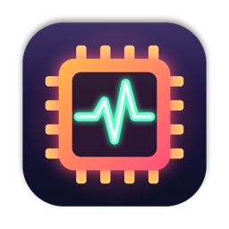

<p align="center">
  
</p>

<h1 align="center">memory-watchdog</h1>

<p align="center">
  Stops runaway processes from freezing your Mac.
</p>

---

When a macOS machine runs out of memory, it doesn't fail cleanly. Swap fills up, and the system starts killing its own helper processes. Apps hang, windows stop responding, and sometimes the only fix is a hard reboot. The process that caused it is usually something you would have happily killed yourself: a TypeScript language server that grew to 11 GB, a stuck test runner, or a Chrome tab with a memory leak.

memory-watchdog is a small background daemon that does that for you. It watches macOS memory pressure, and when pressure turns critical it kills the single largest process that you have marked as killable. It then shows a notification telling you what it killed and how much memory that freed.

```
2026-11-17 19:24:45 critical pressure: killing pid=6411 11011MB [dev tools]: .../@effect/tsgo-darwin-arm64/artifact
```

## Features

- **Acts only under real pressure.** It reads the kernel's own memory pressure level, so it does nothing while your Mac is coping. A large process alone is never a reason to kill.
- **Kills only what you allow.** Rules in a TOML config file list the processes it may kill, each with its own size threshold. Anything that matches no rule is never touched, and neither is anything owned by another user.
- **Kills one process at a time.** It picks the largest matching process, sends `SIGTERM`, and sends `SIGKILL` 3 seconds later only if the process is still alive. It then waits for memory to settle before it considers another kill.
- **Uses accurate memory numbers.** It ranks processes by physical footprint, which includes compressed memory and is the number Activity Monitor shows. RSS undercounts exactly the processes that cause trouble.
- **Shows native notifications.** Notifications come from a tiny bundled app, so they carry the Memory Watchdog icon.
- **Stays out of the way.** It is a single Rust binary that uses about 4 MB of RAM and makes no network calls. It reads system state directly with `sysctl` and `libproc` instead of running `ps` or `top`.
- **Reloads config edits automatically.** Changes take effect within seconds without a restart. If you save a broken config, it logs the error and keeps the previous one.

## Requirements

- macOS 13 or later (developed on Apple Silicon).
- A [Rust toolchain](https://rustup.rs) to build the daemon.
- Xcode Command Line Tools (`xcode-select --install`) to build the notification app.

## Install

```sh
git clone https://github.com/MaximilianLloyd/memory-watchdog.git
cd memory-watchdog
./install.sh
```

The installer does the following:

1. Builds the daemon and the notification app.
2. Installs the daemon to `~/.local/bin/memory-watchdog`.
3. Writes the default config to `~/.config/memory-watchdog/config.toml`, unless you already have one.
4. Installs `Memory Watchdog.app` to `~/Applications` and asks for notification permission. Click **Allow**.
5. Starts the launchd agent `local.memory-watchdog`, which runs at login and restarts if it stops.

To update after pulling new changes, run `./install.sh` again. It keeps your config.

To uninstall, run `./uninstall.sh`. This also leaves your config in place.

## Configuration

Edit `~/.config/memory-watchdog/config.toml`. The [default config](config.toml) protects against JavaScript and TypeScript tooling and Chrome tabs:

```toml
[[rule]]
name = "dev tools"
min_mb = 1500
processes = ["node", "tsc", "tsgo", "tsserver", "vite", "vitest", "jest", "webpack", "eslint"]
patterns = ["/node_modules/"]

[[rule]]
name = "chrome tabs"
min_mb = 500
patterns = ['Google Chrome[^/]*Helper \([^)]*Renderer\)']
label = "Chrome tab"
```

Each `[[rule]]` has the following fields:

| Field | Required | Meaning |
| --- | --- | --- |
| `name` | yes | Shown in logs. |
| `min_mb` | yes | A process must use at least this much memory to be killed under this rule. |
| `processes` | one of these two | Executable names. A name matches when it appears as a whole word in the command line or as the last part of a path, so `node` matches `/opt/homebrew/bin/node server.js` but not `nodemon`. |
| `patterns` | one of these two | Regular expressions ([Rust regex syntax](https://docs.rs/regex/latest/regex/#syntax)) matched against the full command line. |
| `label` | no | Logs and notifications show `<label>: <matched text>` instead of the full command line. |

These global settings are optional:

| Setting | Default | Meaning |
| --- | --- | --- |
| `interval_secs` | `3` | Seconds between pressure checks. |
| `settle_secs` | `5` | Seconds to wait after a kill before considering another. |
| `grace_secs` | `3` | Seconds between `SIGTERM` and `SIGKILL`. |
| `warn_free_percent` | `10` | At *warn* pressure, act if this percentage of memory or less is free. *Critical* pressure always acts. |
| `notify` | `true` | Show a notification for each kill. |

Example: to also cover a Python data job and Docker's VM, add these rules:

```toml
[[rule]]
name = "python"
min_mb = 4000
processes = ["python", "python3"]

[[rule]]
name = "docker vm"
min_mb = 8000
patterns = ["com.apple.Virtualization.VirtualMachine"]
label = "Docker VM"
```

### Check your config

```sh
memory-watchdog check
```

This validates the config and reports the current memory pressure. It also shows what the watchdog would kill right now, without killing anything:

```
config:   /Users/you/.config/memory-watchdog/config.toml
pressure: normal (65% memory available, acts at critical or warn with <= 10%)
rule:     dev tools (min 1500 MB)
rule:     chrome tabs (min 500 MB, label "Chrome tab")
would kill: pid 11945 8195 MB [dev tools] .../@effect/tsgo-darwin-arm64/artifact
```

## Usage

The launchd agent runs the watchdog for you, so you don't need to start it yourself. These commands are useful:

```sh
# What has it done?
tail -f ~/Library/Logs/memory-watchdog.log

# Is it running?
launchctl print gui/$(id -u)/local.memory-watchdog | grep state

# Pause it (until next login or ./install.sh)
launchctl bootout gui/$(id -u)/local.memory-watchdog

# Simulate critical pressure once and log the choice, without killing anything
memory-watchdog --once --force --dry-run && tail -1 ~/Library/Logs/memory-watchdog.log
```

| Flag | Environment variable | Meaning |
| --- | --- | --- |
| `--config PATH` | `WATCHDOG_CONFIG` | Use another config file. |
| `--once` | `WATCHDOG_ONCE=1` | Run one check, then exit. |
| `--dry-run` | `WATCHDOG_DRY_RUN=1` | Log what would be killed, but don't kill it. |
| `--force` | `WATCHDOG_FORCE=1` | Act as if pressure were critical. |

## How it works

```
every interval_secs:
  read kern.memorystatus_vm_pressure_level   (1 normal, 2 warn, 4 critical)
  read kern.memorystatus_level               (% memory available)
  if critical, or warn with ≤ warn_free_percent free:
    list all processes                        proc_listallpids
    keep those over the smallest rule min_mb  proc_pid_rusage → ri_phys_footprint
    sort by footprint, largest first
    take the first one that you own and that matches a rule at or above its min_mb
                                              proc_pidinfo (uid), KERN_PROCARGS2 (argv)
    SIGTERM → wait grace_secs → SIGKILL if still alive
    notify, then wait settle_secs
```

Notifications come from `Memory Watchdog.app`, a small Swift helper that posts through `UNUserNotificationCenter`. It needs to be an app bundle so that macOS shows its icon and lets you manage it in **System Settings → Notifications**. If the app is missing or not allowed to notify, the daemon falls back to `osascript`, so you still get a notification, just without the icon. The icon is drawn in code by [`icon/make-icon.swift`](icon/make-icon.swift).

## Development

```sh
cargo test                       # unit tests, including the shipped config
cargo run -- check --config config.toml
./notifier/build-app.sh          # builds target/Memory Watchdog.app
```

## Troubleshooting

- **Notifications have no icon.** Make sure **Memory Watchdog** is allowed in **System Settings → Notifications**. You can check the permission with `~/Applications/Memory\ Watchdog.app/Contents/MacOS/memory-watchdog-notify --status`. If you just changed the icon, run `killall NotificationCenter` to clear the cached one.
- **It isn't killing anything.** Run `memory-watchdog check`. The process might match no rule, or be below that rule's `min_mb`, or belong to another user. Remember that the watchdog only acts under critical pressure.
- **It killed something you need.** Raise that rule's `min_mb`, or narrow its `processes` and `patterns`. The log shows which rule matched.

## License

MIT
